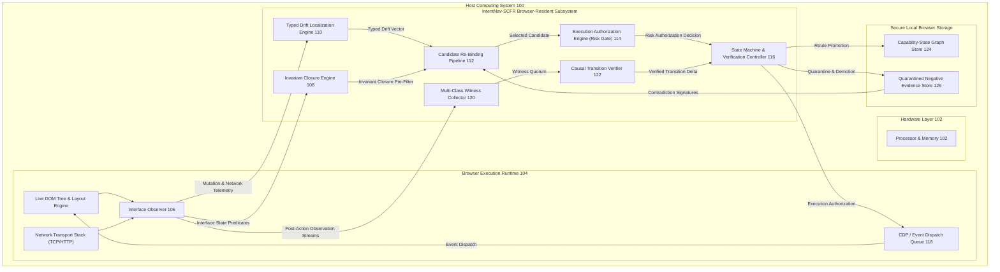
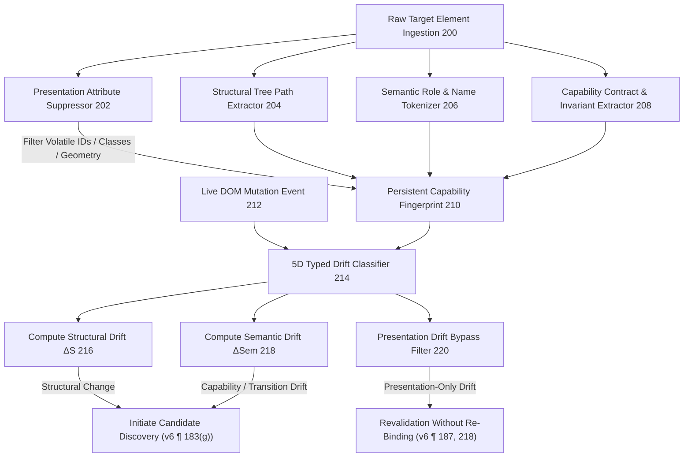
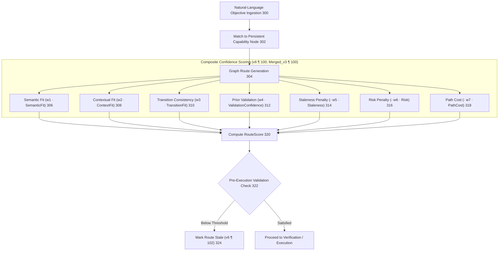
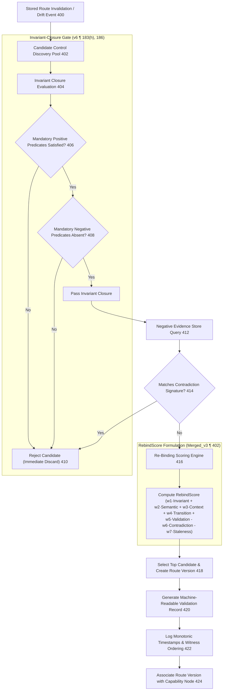
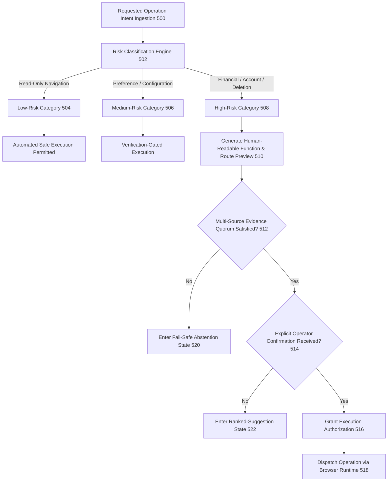
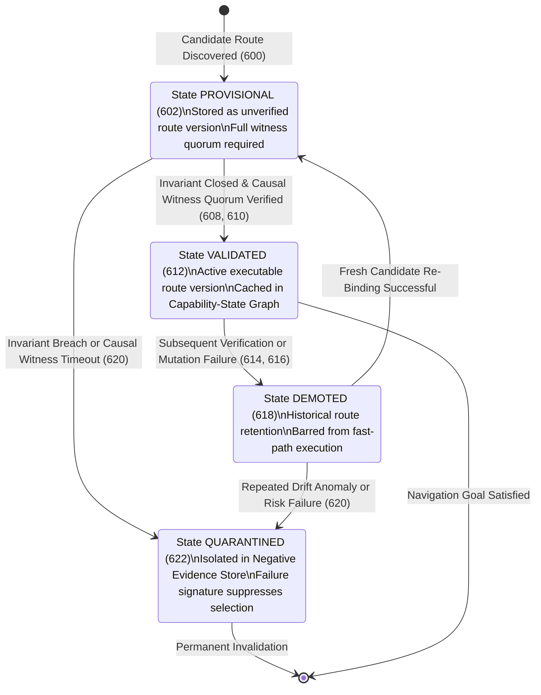

# IntentNav-SCFR: Technical Figures and Diagrammatic Disclosures
**Document Identifier:** `INTENTNAV-SUBMISSION-FIG-2026-V1`
**Author / Inventor / Sole Implementer:** MILIND
**Date:** October 26, 2026
**Status:** Working Patent Draft Deliverable (Reconciled with `v6.docx` Controlling Figures 1–6 at Paragraphs 66, 88, 98, 106, 114, 125)
**Controlling Authority Priority:** `v6.docx` (Controlling Priority 1) $\to$ `patent.docx` (Secondary Priority 2) $\to$ `INTENTNAV-SCFR_AUDITED_IDF-B_DISCLOSURE_Merged_Final_v3.docx` (Tertiary Priority 3)

---

## 1. Brief Description of the Drawings

- **FIG. 1** is a high-level system architecture block diagram illustrating the IntentNav-SCFR computing system and its component interactions within a host operating system, browser rendering engine, and local storage environment (`v6.docx` Paragraph 66).
- **FIG. 2** is a structural process flow diagram illustrating capability-fingerprint construction, volatile presentation attribute suppression, and five-dimensional typed interface drift vector computation (`v6.docx` Paragraph 88).
- **FIG. 3** is a schematic diagram illustrating the semantic capability graph, route version representation, and multi-factor route confidence scoring (`v6.docx` Paragraph 98).
- **FIG. 4** is a process flow diagram illustrating the semantic path-recovery workflow, drift-triggered candidate discovery, invariant-constrained re-binding, and post-drift route version creation (`v6.docx` Paragraph 106).
- **FIG. 5** is a control flow diagram illustrating the risk-gated navigation and execution pipeline, operation risk classification, human-readable previews, and execution authorization (`v6.docx` Paragraph 114).
- **FIG. 6** is a state machine and lifecycle diagram illustrating the closed-loop capability lifecycle from persistent capability identity through drift localization, invariant closure, causal transition verification, provisional quarantine, validated promotion, and negative evidence propagation (`v6.docx` Paragraph 125).

---

## 2. Complete Reference Numeral Dictionary

| Reference Numeral | Disclosed Component / Process Element | Source Basis & Module Mapping |
| :---: | :--- | :--- |
| **100** | IntentNav-SCFR Computing System | `src/index.ts`; `v6.docx` ¶ 66 |
| **102** | Host Processor & Hardware Memory | Hardware execution platform |
| **104** | Client Web Browser Runtime (Blink/WebKit) | Browser event and DOM engine |
| **106** | Browser-Resident Interface Observer | `src/core/observer/domObserver.ts` |
| **108** | Invariant Closure Engine | `src/core/invariants/closure.ts` |
| **110** | Typed Drift Localization Engine | `src/core/drift/detector.ts` |
| **112** | Candidate Re-Binding Pipeline | `src/core/candidate/pipeline.ts` |
| **114** | Execution Authorization Engine (Risk Gate) | `src/core/authorization/riskEngine.ts` |
| **116** | State Machine & Verification Controller | `src/core/stateMachine/machine.ts` |
| **118** | Asynchronous Event Dispatch Queue | CDP / Browser DOM event loop |
| **120** | Multi-Class Transition Witness Collector | `src/core/causal/safeVerification.ts` |
| **122** | Causal Transition Verifier | `src/core/causal/verifier.ts` |
| **124** | Capability-State Graph Store | `src/core/graph/routeManager.ts` |
| **126** | Quarantined Negative Evidence Store | `src/core/contradiction/store.ts` |
| **200** | Raw Target Element Ingestion | `src/core/fingerprint/generator.ts` |
| **202** | Volatile Presentation Attribute Suppressor | `src/core/fingerprint/suppressor.ts`; `v6.docx` ¶ 185 |
| **204** | Structural Tree Path Extractor | `src/core/fingerprint/structural.ts` |
| **206** | Semantic Role & Accessible Name Tokenizer | `src/core/fingerprint/semantic.ts` |
| **208** | Capability Contract & Invariant Extractor | `src/core/fingerprint/capability.ts` |
| **210** | Persistent Capability Fingerprint Record | `src/core/fingerprint/types.ts`; `v6.docx` ¶ 183(c) |
| **212** | Live DOM Mutation Event Receiver | `src/core/observer/mutationBridge.ts` |
| **214** | 5D Typed Drift Classifier | `src/core/drift/classifier.ts`; `v6.docx` ¶ 187, 218 |
| **216** | Structural Distance Calculation ($\Delta S$) | Tree edit distance calculation |
| **218** | Semantic Drift Calculation ($\Delta Sem$) | Embedding cosine distance calculation |
| **220** | Presentation-Only Drift Bypass Gate | `v6.docx` ¶ 187 (`does not by itself invalidate`) |
| **300** | Natural-Language Objective / Intent Ingestion | `src/core/intent/parser.ts`; `v6.docx` ¶ 90 |
| **302** | Persistent Capability Node Matching | `v6.docx` ¶ 98, 100 |
| **304** | Graph Route Generation | `src/core/graph/planner.ts` |
| **306** | Semantic Fit Component ($w_1 \cdot \text{SemanticFit}$) | `Merged_Final_v3.docx` ¶ 100 |
| **308** | Contextual Fit Component ($w_2 \cdot \text{ContextFit}$) | `Merged_Final_v3.docx` ¶ 100 |
| **310** | Transition Fit Component ($w_3 \cdot \text{TransitionFit}$) | `Merged_Final_v3.docx` ¶ 100 |
| **312** | Validation Confidence ($w_4 \cdot \text{ValidationConfidence}$) | Prior execution success history |
| **314** | Staleness Penalty ($- w_5 \cdot \text{Staleness}$) | Elapsed time penalty |
| **316** | Risk Penalty ($- w_6 \cdot \text{Risk}$) | Operation risk penalty |
| **318** | Path Cost Penalty ($- w_7 \cdot \text{PathCost}$) | Graph edge navigation cost |
| **320** | Composite Route Confidence Score (`RouteScore`) | `v6.docx` ¶ 100; `Merged_v3` ¶ 100 |
| **322** | Pre-Execution Validation Check | `v6.docx` ¶ 102 |
| **324** | Stale Route Marking & Invalidation | Evidence below threshold |
| **400** | Stored Route Execution Invalidation / Drift Trigger | `v6.docx` ¶ 104, 183(g) |
| **402** | Live Candidate Control Discovery Pool | `src/core/candidate/discovery.ts` |
| **404** | Invariant Closure Filter Evaluation | `src/core/invariants/evaluator.ts`; `v6.docx` ¶ 183(h) |
| **406** | Mandatory Positive Predicates Check | Tag, container role, capability role |
| **408** | Mandatory Negative Predicates Check | Disabled, aria-hidden, readonly |
| **410** | Invariant Violation Rejection (Immediate Discard) | Candidate rejected before ranking |
| **412** | Negative Evidence Store Contradiction Check | `src/core/contradiction/store.ts`; `v6.docx` ¶ 189 |
| **414** | Contradiction Signature Match Pruning | Decoy action & incompatible state discard |
| **416** | Re-Binding Scoring Engine (`RebindScore`) | `Merged_Final_v3.docx` ¶ 402; `v6.docx` ¶ 183(i) |
| **418** | Candidate Selection & Route Version Generation | `v6.docx` ¶ 104, 183(j) |
| **420** | Machine-Readable Validation Record Generation | `v6.docx` ¶ 183(j), 199, 217 |
| **422** | Activation-Event & Witness Ordering Logging | Monotonic timestamp logging |
| **424** | Route Association with Capability Node | Graph version history update |
| **500** | Requested Operation Intent Ingestion | `src/core/authorization/riskEngine.ts`; `v6.docx` ¶ 108 |
| **502** | Risk Classification Engine | Low, Medium, High risk categorization |
| **504** | Low-Risk Route Evaluation (Read-Only Navigation) | Automated execution permitted |
| **506** | Medium-Risk Route Evaluation (Preferences/Config) | Verification-gated execution |
| **508** | High-Risk Route Evaluation (Financial/Delete/Security)| Multi-source authorization required |
| **510** | Human-Readable Function & Route Preview | `v6.docx` ¶ 108 |
| **512** | Multi-Source Evidence Quorum Evaluation | Semantic + Invariant + Transition quorum (¶ 197) |
| **514** | Operator Confirmation Ingestion | Explicit operator confirmation signal / input |
| **516** | Execution Authorization Gate Decision | Independent of capability confidence (¶ 183(m)) |
| **518** | Safe Execution Dispatch Trigger | Event dispatch queue release |
| **520** | Fail-Safe Abstention State | Uncertainty as executable state (¶ 124, 183(n)) |
| **522** | Ranked-Suggestion Disambiguation State | Interactive disambiguation prompt |
| **600** | Candidate Identification / Initial Ingestion | Initial route ingestion; `v6.docx` ¶ 125 |
| **602** | `PROVISIONAL` State | Initial quarantined state (¶ 122, 183(j), 192) |
| **604** | Invariant Closure Gate Evaluation | Positive/negative predicates test (¶ 183(h)) |
| **606** | Ordered Transition Witness Collection | Multi-class witness observation (¶ 119, 183(k)) |
| **608** | Causal Transition Verification Decision | Ordered delta matching within interval (¶ 120) |
| **610** | Fast-Path Promotion Transition | Promotion to active executable set (¶ 122, 183(l)) |
| **612** | `VALIDATED` State | Active executable route version in graph |
| **614** | Subsequent Interface Drift / Execution Failure | Post-action failure or anomaly |
| **616** | Route Demotion Transition | Active route demotion (¶ 122, 193) |
| **618** | `DEMOTED` State | Demoted route version; historical retention |
| **620** | Quarantine State Transition | Invariant breach or contradiction failure |
| **622** | `QUARANTINED` State (Negative Evidence Store) | Stored failure signature suppressing reuse (¶ 122, 200) |

---

## 3. Editable Source Diagrams and Statutory Descriptions

---

### FIG. 1: System Architecture and Component Interactions

#### Detailed Description of FIG. 1
FIG. 1 illustrates the overall computing system **100** configured for adaptive navigation of an asynchronous web interface (`v6.docx` Paragraph 66). The system comprises hardware processors and memory **102** executing a client web browser runtime **104**. A browser-resident interface observer **106** continuously monitors the live Document Object Model (DOM) and network transport events. The core browser-resident subsystem comprises an invariant closure engine **108**, a typed drift localization engine **110**, a candidate re-binding pipeline **112**, an execution authorization engine **114**, a state machine and verification controller **116**, an event dispatch queue **118**, a multi-class transition witness collector **120**, and a causal transition verifier **122**, maintaining routes across a capability-state graph store **124** and a quarantined negative evidence store **126**.

---

### FIG. 2: Capability-Fingerprint Construction and 5D Typed Drift Detection

#### Detailed Description of FIG. 2
FIG. 2 depicts capability-fingerprint construction and 5-dimensional typed interface drift detection (`v6.docx` Paragraph 88). Raw target elements **200** are processed by the volatile presentation attribute suppressor **202**, which excludes dynamic identifiers, transient framework classes, randomized tokens, and layout coordinates (`v6.docx` Paragraph 185). Structural paths **204**, semantic tokens **206**, and capability invariants **208** are serialized into a persistent capability fingerprint **210**.

When mutations occur (**212**), the typed drift classifier **214** computes a typed drift vector $[ \Delta P, \Delta C, \Delta S, \Delta \text{Cap}, \Delta T ]$. Presentation-only drift ($\Delta P > 0$, $\Delta S = 0$, $\Delta \text{Cap} = 0$) passes through bypass gate **220** preserving the validated route without full re-binding (`v6.docx` Paragraph 187, 218), whereas structural or capability drift triggers candidate discovery.

---

### FIG. 3: Semantic Capability Graph and Route-Ranking Illustration

#### Detailed Description of FIG. 3
FIG. 3 illustrates the semantic capability graph store, route representation, and composite route confidence scoring (`v6.docx` Paragraph 98). A natural-language objective **300** is matched to a persistent capability node **302**, retrieving candidate routes through the graph **304**. In accordance with `v6.docx` Paragraph 100 and `Merged_Final_v3.docx` Paragraph 100, each route receives a composite confidence score:
$$\text{RouteScore} = w_1\text{SemanticFit} + w_2\text{ContextFit} + w_3\text{TransitionFit} + w_4\text{ValidationConfidence} - w_5\text{Staleness} - w_6\text{Risk} - w_7\text{PathCost}$$
where weights $w_1 \dots w_7$ may be tuned experimentally. If validation falls below a configurable threshold (**322**), the route is marked stale (**324**), triggering recovery.

---

### FIG. 4: Semantic Path-Recovery Flow and Invariant-Constrained Re-Binding

#### Detailed Description of FIG. 4
FIG. 4 illustrates the semantic path-recovery workflow (`v6.docx` Paragraph 106). When a stored route breaks (**400**), the recovery engine discovers live candidate controls **402**. Candidates must pass through the invariant-closure gate **404**, which deterministically tests mandatory positive predicates **406** and mandatory negative predicates **408** (`v6.docx` Paragraph 183(h), 186). Any failing candidate is rejected before similarity ranking (**410**).

Surviving candidates are queried against the negative evidence store **412** to filter out contradiction signatures and adversarial decoes **414** (`v6.docx` Paragraph 189). Eligible candidates are scored by the re-binding engine **416** using the representative formula from `Merged_Final_v3.docx` Paragraph 402:
$$\text{RebindScore} = w_1\text{InvariantFit} + w_2\text{SemanticFit} + w_3\text{ContextFit} + w_4\text{TransitionFit} + w_5\text{ValidationHistory} - w_6\text{Contradiction} - w_7\text{Staleness}$$
The selected candidate is packaged into a new route version (**418**) with a machine-readable validation record (**420**) storing monotonic activation-to-witness ordering (**422**) and associated with the persistent capability node (**424**).

---

### FIG. 5: Risk-Gated Navigation and Multi-Source Authorization Flow

#### Detailed Description of FIG. 5
FIG. 5 illustrates the risk-gated navigation and execution pipeline (`v6.docx` Paragraph 114). The risk engine classifies requested operations into risk categories **502** (`v6.docx` Paragraph 108): low risk **504** (read-only), medium risk **506** (preferences), and high risk **508** (financial transactions, credential submissions, account deletion).

For high-risk operations, the system presents a human-readable preview of the found function and route **510** and enforces an evidence quorum **512** requiring semantic evidence, functional invariant evidence, and transition-state evidence (`v6.docx` Paragraph 197). Execution authorization **516** is strictly decoupled from capability confidence (`v6.docx` Paragraph 183(m)); high confidence cannot override failure of the evidence quorum. When conditions are unmet, the system enters an explicit fail-safe abstention state **520** or ranked-suggestion state **522** (`v6.docx` Paragraph 124, 183(n)).

---

### FIG. 6: Closed-Loop Capability Lifecycle and Route State Machine

#### Detailed Description of FIG. 6
FIG. 6 depicts the closed-loop capability lifecycle and route version state machine (`v6.docx` Paragraph 125). Newly discovered or re-bound routes enter the `PROVISIONAL` state **602** (`v6.docx` Paragraph 122, 183(j), 192). A provisional route transitions to `VALIDATED` **612** if and only if both the invariant-closure condition and causal transition-verification acceptance condition are satisfied (**608**, **610**).

If verification fails or invariants are breached, the route moves to `QUARANTINED` **622** and is stored as negative evidence to suppress repeated false selection (`v6.docx` Paragraph 200). An active `VALIDATED` route that fails in subsequent execution transitions to `DEMOTED` **618**, restoring a previously validated route or forcing fresh recovery (`v6.docx` Paragraph 193). All state transitions are caused by invariant and transition-witness evidence, never by confidence score alone (`v6.docx` Paragraph 201).

---
*Signed and Authenticated:*
**MILIND**
Sole Architect & Implementer, IntentNav-SCFR
